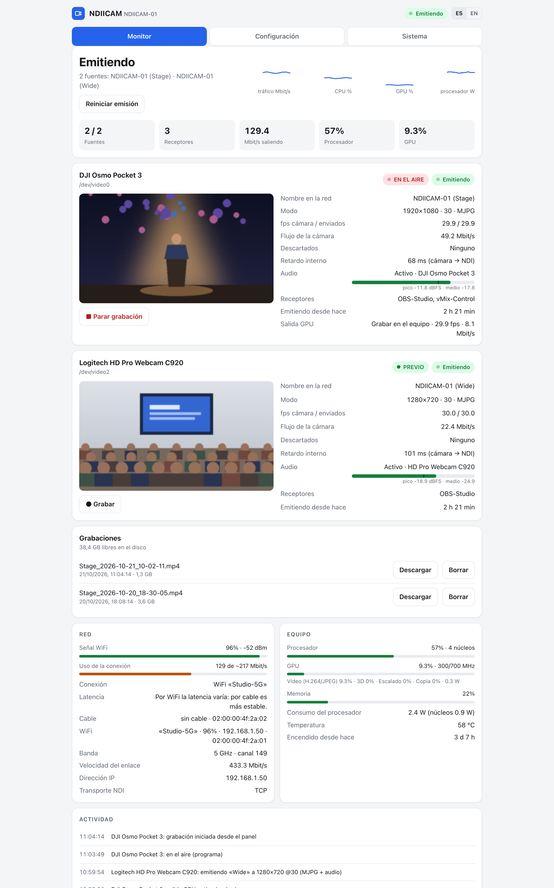
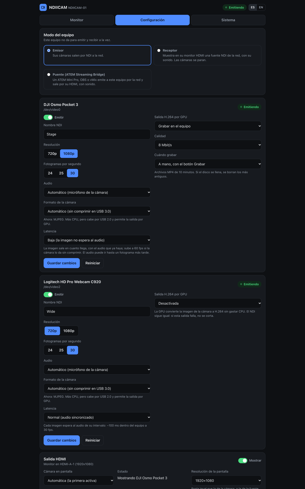
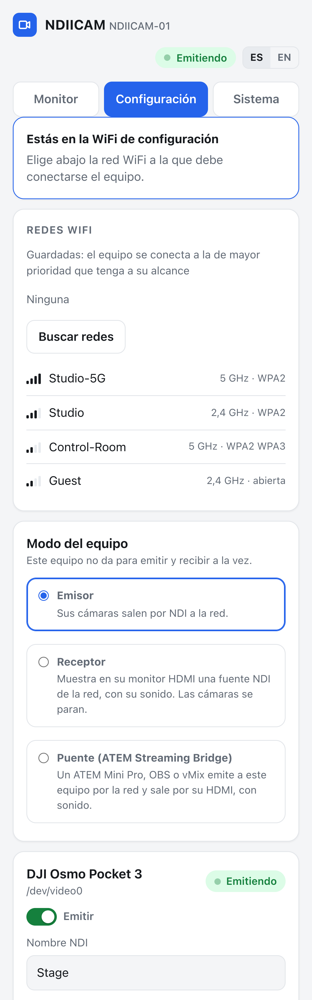
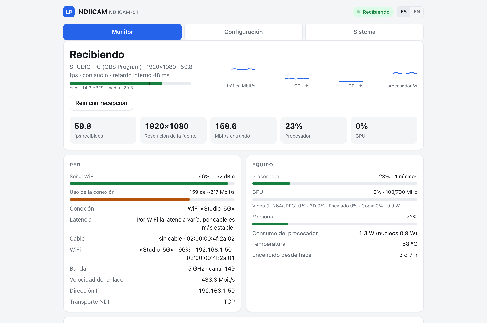

# NDIICAM

**Convierte cualquier PC x86_64 con Linux (Intel/AMD) y una cámara USB en una cámara NDI® lista para usar.**

[English](README.md)

Conectas una cámara USB a un PC pequeño y aparece como fuente NDI en tu red: en OBS,
vMix, NDI Studio Monitor o cualquier receptor NDI. O al revés: en **modo receptor** muestra
una fuente NDI de la red en la tele o el monitor conectado a su HDMI, con sonido. Todo se
gestiona desde un panel web: tras la instalación no hace falta la terminal.

## Capturas



<table>
  <tr>
    <td width="68%"></td>
    <td width="32%"></td>
  </tr>
  <tr>
    <td align="center">El tema oscuro sigue al del sistema</td>
    <td align="center">WiFi de configuración desde el móvil</td>
  </tr>
</table>



<sub>Las capturas usan datos de demostración (<code>docs/screenshots/demo.py</code>).</sub>

## Funciones

- **Emite cada cámara UVC conectada como fuente NDI propia** (MJPEG o YUYV) a 720p o 1080p,
  hasta 60 fps, **con el micrófono de la cámara** como audio NDI si lo tiene.
- **Panel web** en `http://<equipo>.local`: estado en vivo, fps, tasa de datos, receptores
  conectados, señal WiFi y uso del enlace, CPU y temperatura. En español e inglés.
- **WiFi de configuración**: si no hay ninguna red conocida, el equipo crea su propia WiFi
  con portal cautivo. Te conectas desde el móvil, eliges tu red, pones la clave y listo.
- **Se recupera solo**: detecta la cámara al enchufarla, reinicia la emisión si la cámara
  deja de dar imagen y vuelve a las redes conocidas cuando reaparecen.
- **Monitor de encuadre por HDMI**: muestra una cámara a pantalla completa en el monitor conectado al
  equipo, directo a la GPU y sin gastar CPU. Se activa y desactiva desde el panel.
- **Modo receptor**: el equipo para sus cámaras y se convierte en receptor NDI: eliges cualquier
  fuente NDI de la red (OBS, vMix, una app del móvil, otro NDIICAM…) y sale por el HDMI con su
  audio. Si la fuente se va, se reconecta solo. Un Atom pequeño no da para emitir y recibir a la
  vez, así que es un modo o el otro.
- **Salida H.264 por la GPU**, por cámara y a la vez que el NDI: **grabar** archivos MP4 en el
  equipo (se descargan desde el panel), servir un flujo **SRT** para OBS, vMix o VLC, o **emitir
  por RTMP** a YouTube, Twitch y similares. La GPU decodifica el JPEG de la cámara y codifica el
  H.264, así que gasta poca CPU; si falla, el NDI sigue. GPU Intel con VA-API.
- **Modo puente, como un ATEM Streaming Bridge**: un ATEM Mini Pro, OBS o vMix emite al equipo
  por RTMP o SRT y sale por su HDMI con el sonido. El panel da el archivo de ajustes para cargarlo
  en ATEM Software Control.
- **Uso de la GPU en el panel**: lo ocupada que está, su motor de vídeo, frecuencia y consumo.
- **Medidor de audio**: pico y nivel medio en dBFS de cada cámara, y de lo que reproducen el
  receptor o el puente. Sabes antes de salir al aire si un micro está mudo, bajo o saturado.
- **Grabar en un horario o a demanda**: la grabación por GPU de cada cámara puede ir siempre,
  solo mientras haya receptores NDI conectados, o entre dos horas del día (también de noche).
  Arranca y para sin tocar la emisión NDI.
- **Tally**: cuando un receptor como OBS, vMix o un TriCaster pone una cámara en programa o en
  previo, el panel marca **EN EL AIRE** o **PREVIO** en esa cámara y lo apunta en la actividad. Sale
  del NDI SDK a través de un parche pequeño que NDIICAM añade al plugin NDI de GStreamer
  (`plugin/`), que además cuenta los receptores que ve el SDK.
- **Pantalla de ayuda por HDMI**: cuando no hay nada que mostrar, el monitor conectado al equipo
  enseña su estado, modo, red, IP y un **QR que abre el panel**, en vez del login de Linux. En el
  idioma que elijas en el panel. No gasta CPU.
- **IP fija, copia de seguridad, valores de fábrica y actualización con un clic** desde el panel.
- **Decodificación JPEG adaptativa**: si la imagen de la cámara se vuelve demasiado detallada para
  un núcleo (noche, público, follaje), la decodificación se reparte sola en más hilos y los 1080p30
  se mantienen.
- **Ligero**: un único servicio en Python sobre GStreamer, sin frameworks web ni base de datos.
  Dividido en módulos pequeños (ver la cabecera de `ndiicam/ndiicam.py`), con pruebas que corren
  sin hardware (`python3 -m unittest discover -s tests`).

## Requisitos

| | |
|---|---|
| CPU | x86_64 Intel o AMD. Un Atom x5-Z8350 (4 núcleos, 1,44 GHz) emite 1080p30 con ~1,6 núcleos y lo recibe con ~0,6-0,9 |
| Sistema | Ubuntu 24.04 LTS (probado). Debian 12+ debería funcionar |
| Cámara | Cámara USB UVC con MJPEG (la mayoría de webcams, DJI Osmo Pocket 3 en modo webcam…). Las capturadoras baratas de HDMI a USB también son UVC MJPEG y deberían funcionar como una cámara más (sin probar aún) |
| Tarjeta WiFi (opcional) | Necesaria para la WiFi de configuración. Las que admiten AP y cliente a la vez (p. ej. Intel 3165) no sueltan la conexión mientras está activa |

## Instalación

```bash
git clone https://github.com/ithesk/NDIICAM.git
cd NDIICAM
sudo ./install.sh
```

O en una línea:

```bash
curl -fsSL https://raw.githubusercontent.com/ithesk/NDIICAM/main/install.sh | sudo bash -s -- --accept-ndi-license
```

El instalador:

1. Instala las dependencias (GStreamer, NetworkManager, hostapd, Avahi…).
2. Descarga el runtime del **NDI® SDK** de los servidores oficiales de NDI. Es software
   privativo de Vizrt NDI AB: te pide aceptar su licencia (`--accept-ndi-license` la
   acepta sin preguntar).
3. Instala el plugin NDI de GStreamer de
   [gst-plugins-rs](https://gitlab.freedesktop.org/gstreamer/gst-plugins-rs) (MPL-2.0),
   precompilado por la CI de este repositorio (`--build-plugin` lo compila en el equipo).
4. Instala y arranca el servicio `ndiicam`.
5. Pasa la red a **NetworkManager** si la gestionan netplan y systemd-networkd (Ubuntu
   Server). La red se corta unos segundos; si no vuelve en 90 s, se restaura sola la
   configuración anterior. Se omite con `--no-network`. Conserva la identidad DHCP, así que
   el router sigue dando la misma IP.

Volver a ejecutar el instalador actualiza NDIICAM y conserva la configuración.

## Primer uso

1. Conecta la cámara. La emisión empieza sola.
2. Abre `http://<equipo>.local` (el instalador te da la dirección).
3. En OBS: *Añadir fuente → NDI Source* (con [DistroAV](https://github.com/DistroAV/DistroAV))
   y elige `<EQUIPO> (NDIICAM)`.

**¿Sin red?** Tras 60 s sin ninguna red conocida, el equipo activa la WiFi de configuración
`NDIICAM-XXXX` (clave `ndiicam-setup`, cámbiala en el panel). Conéctate desde el móvil: el
panel se abre solo. Elige tu red y escribe su clave. El resultado sale en la misma pantalla;
después vuelve a tu red y abre `http://<equipo>.local`.

## Panel

Dos pestañas: **Monitor** (lo que pasa) y **Configuración** (lo que cambias). `#monitor` y
`#config` en la URL abren una directamente.

| Pestaña | Sección | Qué hace |
|---|---|---|
| Monitor | Estado | Estado general, fuentes emitiendo, receptores, Mbit/s de salida, CPU, GPU, gráficas de los últimos 2 minutos |
| Monitor | Una tarjeta por cámara | Vista previa (un JPEG de la cámara cada 2 s), nombre NDI, modo, fps de cámara/enviados, tasa, descartes, audio con medidor, receptores por nombre, salida GPU |
| Monitor | Grabaciones, Red, Equipo, Actividad | Archivos grabados, señal WiFi y uso del enlace, CPU/GPU/memoria/consumo, registro de eventos |
| Configuración | Una tarjeta por cámara | Activar/desactivar, nombre NDI, 720p/1080p, fps, audio (micro de la cámara, otra entrada o ninguno), salida H.264 por la GPU (grabar, SRT o RTMP), su calidad y cuándo grabar |
| Configuración | Modo del equipo | Emisor (cámaras a NDI), receptor (una fuente NDI al HDMI) o puente (RTMP/SRT de un ATEM al HDMI) |
| Configuración | Puente | Solo en modo puente: servidor RTMP y clave, dirección SRT, quién emite, archivo de ajustes para ATEM Software Control, clave nueva |
| Configuración | Receptor NDI | Solo en modo receptor: fuentes NDI encontradas en la red, cuál mostrar, resolución, fps y audio recibidos |
| Configuración | Salida HDMI | Activar/desactivar, qué cámara, estado del monitor, resolución de la pantalla al arrancar |
| Configuración | Actualizaciones | Versión instalada y última, comprobar, instalar con un clic |
| Configuración | Redes WiFi | Redes guardadas (olvidar), buscar, conectar |
| Configuración | Dirección IP | DHCP o fija, para la conexión activa o para el puerto de cable (aunque no esté enchufado: se guarda y se aplica al conectarlo). Si con la fija no hay conexión, vuelve sola a la anterior |
| Configuración | Equipo | Nombre del equipo, transporte NDI, nombre y clave de la WiFi de configuración, país, idioma de la pantalla de ayuda HDMI, contraseña opcional del panel, descargar/restaurar copia, valores de fábrica, reiniciar |

La contraseña del panel no se pide desde la WiFi de configuración: quien está en ella ya
conoce su clave, y es la forma de volver a entrar si se olvida la del panel.

## Notas técnicas

Salen de montarlo en hardware real y explican algunos valores por defecto:

- **El transporte NDI va por TCP.** Con el UDP fiable que NDI 6 usa por defecto, algunos
  receptores (OBS en macOS en nuestras pruebas) veían la fuente pero nunca recibían vídeo.
  TCP funciona en todos. Se puede cambiar a UDP en el panel.
- **Avahi es imprescindible.** El NDI SDK en Linux anuncia las fuentes a través de Avahi;
  sin él la emisión funciona pero ningún receptor la encuentra.
- **Se desactiva el ahorro de energía de la WiFi** (`wifi.powersave = 2`): provoca tirones
  en un flujo constante de ~90 Mbit/s.
- **El pipeline va repartido en hilos.** Decodificación, conversión de color y codificación
  NDI corren en hilos distintos con colas que descartan. En un solo hilo, un Atom solo llega
  a ~22 fps a 1080p; repartido, mantiene 30 fps. Si la CPU se queda atrás, se descartan
  fotogramas viejos en vez de acumular retraso.
- **Sin GPU, medido de tres formas.** En Intel Cherry Trail (driver i965) `vaapijpegdec` va a
  30-60 fps con un 10-40% de CPU, pero todos los fotogramas salen negros: las superficies decodificadas
  no se pueden leer desde memoria. El driver no expone procesado de vídeo (VPP), así que tampoco hay
  escalado ni conversión por GPU. OpenGL ES funciona sin pantalla (EGL/GBM) y escala 720p→1080p a
  memoria con un 24% de CPU, pero al alimentar `kmssink` desde ahí cae a 11 fps. La codificación
  SpeedHQ de NDI es solo por CPU en cualquier caso; NDI|HX con H.264 por hardware exigiría el NDI
  Advanced SDK.
- **La decodificación JPEG es el cuello de botella del emisor.** `jpegdec` va en un solo hilo: un
  fotograma real de cámara a 1080p30 (~210 KB) cuesta el 68% de un núcleo, y uno muy detallado más
  del 100%, con lo que cae a ~21 fps mientras los demás núcleos no hacen nada. La conversión de color
  es barata (10-16%) y mandar I420 al NDI en vez de UYVY no ahorra nada (el SDK convierte por dentro).
  Con `decodificadores` en automático, el servicio arranca con uno y, cuando la cámara entrega más
  fotogramas de los que salen por NDI, reinicia la fuente repartiendo los fotogramas por turnos entre
  2-3 decodificadores, reordenados después. Escalado medido: 1 → 21,8 fps, 2 → 40,5, 3 → 59,3 fps con
  fotogramas pesados; +10% de CPU cuando no hace falta.
- **La salida HDMI va directa a un plano de vídeo de la GPU** (`kmssink`, UYVY): no gasta CPU.
  Algunos planos no escalan (Intel Cherry Trail): para verla a pantalla completa, pon en el panel la
  resolución de la pantalla igual a la de la cámara. Escribe `video=` en
  `/etc/default/grub.d/90-ndiicam.cfg` y requiere reiniciar. Las entradas de GRUB personalizadas con
  la línea de arranque fija no lo recogen: añádeles `video=1920x1080@60` a mano. Convertir a RGB para
  escalar por CPU cuesta +70-150% de CPU en un Atom.
- **El modo receptor también muestra la fuente en un plano de vídeo de la GPU.** NDI decodifica a
  UYVY, que va al plano tal cual: recibir 1080p30 costó ~0,6-0,9 núcleos en el Atom, según la imagen.
  `kmssink` necesita `skip-vsync`, o espera dos refrescos por imagen y se queda en 30 fps en una
  pantalla de 60 Hz. Las fuentes de otra resolución se escalan por CPU (vecino más próximo, con
  bordes), y eso es caro: el filtro "NDI Output" por fuente de OBS manda cada fuente a su tamaño
  original **con transparencia**, y una captura de pantalla de 2530×1378 gastó ~3 núcleos y llegó a
  colgar el Atom. Manda el programa (salida principal de DistroAV, resolución de salida de OBS = la
  de la pantalla). El receptor corre con prioridad baja y deja un núcleo libre al sistema y la red.
- **El consumo del procesador** del panel sale de Intel RAPL y solo cubre el SoC (CPU + GPU), no la
  WiFi, la memoria, la placa ni la cámara. En el Atom: 0,9 W en reposo, 1,7 W emitiendo 1080p30.
- **La salida H.264 por la GPU** toma el JPEG de la cámara, lo decodifica en la GPU (`vajpegdec`)
  y codifica allí mismo el H.264 (`vah264enc` o `vah264lpenc`), en un pipeline propio alimentado
  con copias: si fallan la GPU, la red o el disco, el NDI no se entera, y la salida se reintenta
  cada 10 s. En un Celeron J3355 cuesta ~15 % de un núcleo con el NDI a 1080p30 a la vez. El NDI
  no puede usar la GPU: en estos chips devolver a memoria una imagen decodificada cuesta más que
  decodificarla por CPU (145 ms por imagen 1080p en Apollo Lake, frente a 14 ms por CPU). Las
  grabaciones son MP4 fragmentado (se leen aunque se corte la luz), de 10 minutos, en
  `/var/lib/ndiicam/grabaciones`; si quedan menos de 2 GB se borran las más antiguas.
- **Las GPU Intel Gen9 (Skylake a Gemini Lake) necesitan el firmware HuC** para su codificador de
  bajo consumo, y el kernel no lo carga: sin él, ese codificador **colgó el equipo entero**. El
  instalador añade `i915.enable_guc=2` (en `/etc/default/grub.d/80-ndiicam-huc.cfg`) y pide
  reiniciar; mientras tanto la salida GPU queda desactivada. También instala
  `intel-media-va-driver` (iHD): el driver antiguo, i965, no entrega un JPEG 4:2:0 decodificado.
- **El modo puente** usa [MediaMTX](https://github.com/bluenviron/mediamtx) como servidor RTMP (1935)
  y SRT (8890), aceptando solo `live/<clave>`, y lo saca por HDMI. Decodifica el H.264 con FFmpeg
  por CPU: 1080p30 usó ~45 % de la CPU de un Celeron J3355, y 1080p60 también se decodifica. En
  Apollo Lake la GPU lo decodifica con la décima parte, pero sus imágenes no llegan a la pantalla
  sin copias: los planos de vídeo no aceptan NV12, iHD no tiene procesador de vídeo ahí, i965 falla
  en GStreamer 1.24 y OpenGL directo sobre KMS colgó el equipo. Una pantalla 4K va a 30 Hz en
  estos chips: para 60 fps, pon la pantalla a 1080p en el panel.
- **La pantalla de ayuda del HDMI** es un PNG dibujado con Pillow (el QR con segno) y mostrado con
  `kmssink` en pausa: el fotograma de preparación se queda en el plano de vídeo y el proceso no
  vuelve a trabajar. El servicio lo relanza cuando cambian la IP, el modo o el estado, y lo para
  antes de que una cámara o el receptor cojan el HDMI. El instalador desactiva la consola de texto
  de tty1 (`getty@tty1`) para que no pelee por la pantalla; Alt+F2 sigue abriendo una consola.
- **El tally y el número de receptores** necesitan `NDIlib_send_get_tally` y
  `NDIlib_send_get_no_connections` del NDI SDK, que el plugin NDI de GStreamer no expone.
  `plugin/ndisink-tally.patch` los añade a `ndisink` como propiedades de solo lectura
  (`tally-program`, `tally-preview`, `connections`); la CI y el instalador lo aplican antes de
  compilar. Con el plugin sin parchear, NDIICAM simplemente no enseña el tally.
- **El uso de la GPU** sale del kernel sin instalar nada: el tiempo que trabaja cada motor
  (`drm-engine-*` en el fdinfo de cada cliente), el tiempo en reposo (RC6), la frecuencia
  (`gt_act_freq_mhz`) y el dominio `uncore` de RAPL para el consumo.
- **La WiFi de configuración usa una interfaz virtual `ap0`** cuando la tarjeta lo permite,
  así el equipo sigue buscando sus redes mientras tanto. Si no, alterna: 3 minutos de AP y
  45 s buscando redes, mientras nadie esté conectado al AP.

## Retardo

Medido en un Celeron J3355 por WiFi de 5 GHz (octubre de 2026). El panel enseña en vivo el retardo
interno de cada cámara (cámara → NDI) y del receptor o el puente (→ HDMI).

| Camino | Retardo | Notas |
|---|---|---|
| NDI, del emisor a un receptor de la red | ~25 ms de mediana, el 10 % de los fotogramas por encima de 200 ms | Vaivén de la WiFi; por cable es más estable. Súmale el retardo propio de la cámara y el interno que enseña el panel |
| Salida H.264 por GPU (grabar, SRT, RTMP) | ~200 ms en codificar y empaquetar | Más el búfer del reproductor: el SRT va configurado con 200 ms; OBS y VLC añaden el suyo |
| Puente, RTMP de entrada → HDMI | de 0,6 a 1,4 s dentro del equipo | Los servidores RTMP entregan a un lector nuevo desde el último fotograma clave, así que el desfase depende de cuándo se conectó. Más el retardo del codificador del ATEM. No es un camino de baja latencia |
| Botón Grabar | arranca con el siguiente fotograma | la primera vez reinicia además la emisión de la cámara (~2 s) para activar la salida GPU |

## Problemas frecuentes

| Problema | Qué mirar |
|---|---|
| La fuente no aparece en el receptor | `avahi-daemon` activo; receptor y equipo en la misma red/VLAN; que la WiFi no aísle a los clientes ni bloquee mDNS |
| Aparece la fuente pero sin imagen | Pon el transporte en TCP desde el panel |
| Tirones por WiFi | Barra de uso del enlace en el panel; 5 GHz; 720p; mejor por cable |
| El modo receptor va lento | La fuente no tiene la resolución de la pantalla o trae transparencia: mándala a la resolución de la pantalla (en OBS, salida principal de DistroAV) |
| Los fps de cámara superan a los fps NDI en una cámara MJPEG | La decodificación no da abasto; el servicio añade hilos solo (evento "la decodificación no da abasto"). A mano, en *Equipo → Decodificación JPEG* |
| El panel no abre | `systemctl status ndiicam`; otro programa en el puerto 80 |
| Registros | `journalctl -u ndiicam -f`; el del cambio de red en `/var/lib/ndiicam/red.log` |

## Desinstalar

```bash
sudo ./uninstall.sh                  # quita NDIICAM y deja la red como está
sudo ./uninstall.sh --restore-network --purge   # además restaura netplan/networkd y borra SDK, plugin y ajustes
```

## Licencia

NDIICAM es software libre bajo la **GNU General Public License v3.0 o posterior**
([LICENSE](LICENSE)). Copyright © 2026 Pablo Holguín.

NDIICAM no incluye el NDI® SDK: el instalador lo descarga de NDI y se rige por su propia
licencia. **NDI® es una marca registrada de Vizrt NDI AB.** NDIICAM no está afiliado a
Vizrt NDI AB ni cuenta con su respaldo. El plugin NDI de GStreamer forma parte de
gst-plugins-rs (MPL-2.0). El modo puente usa [MediaMTX](https://github.com/bluenviron/mediamtx) (MIT),
que descarga el instalador. **ATEM es una marca de Blackmagic Design**; NDIICAM no está afiliado
a Blackmagic Design ni cuenta con su respaldo.
