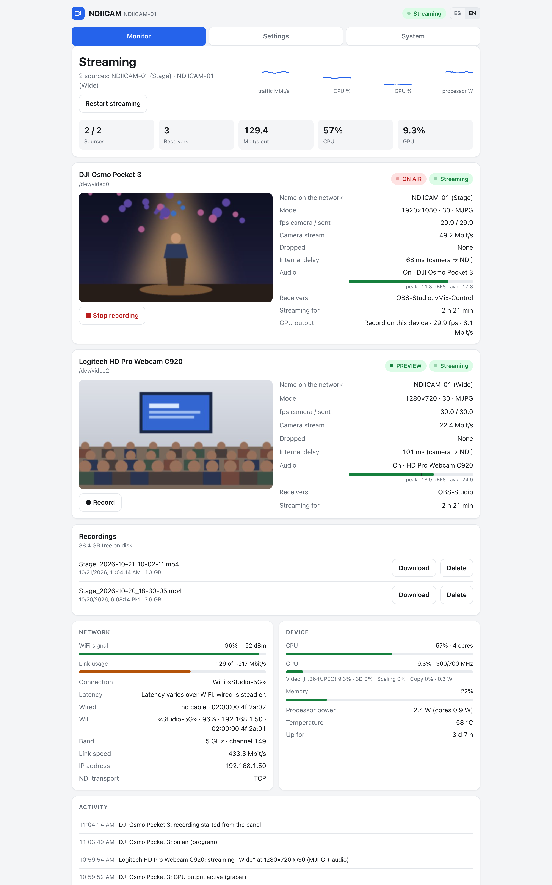
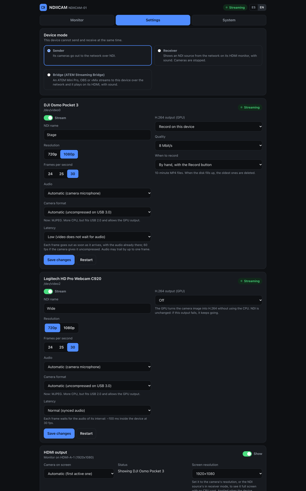
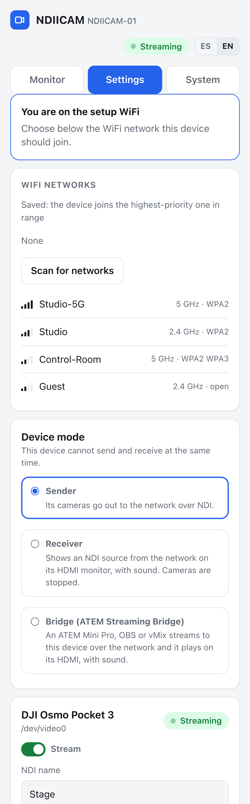
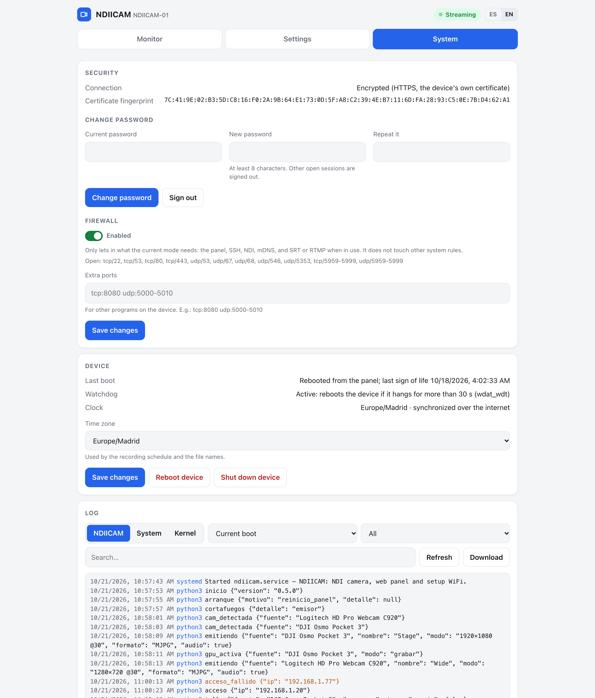
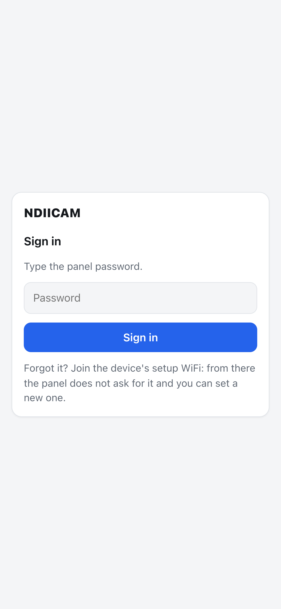
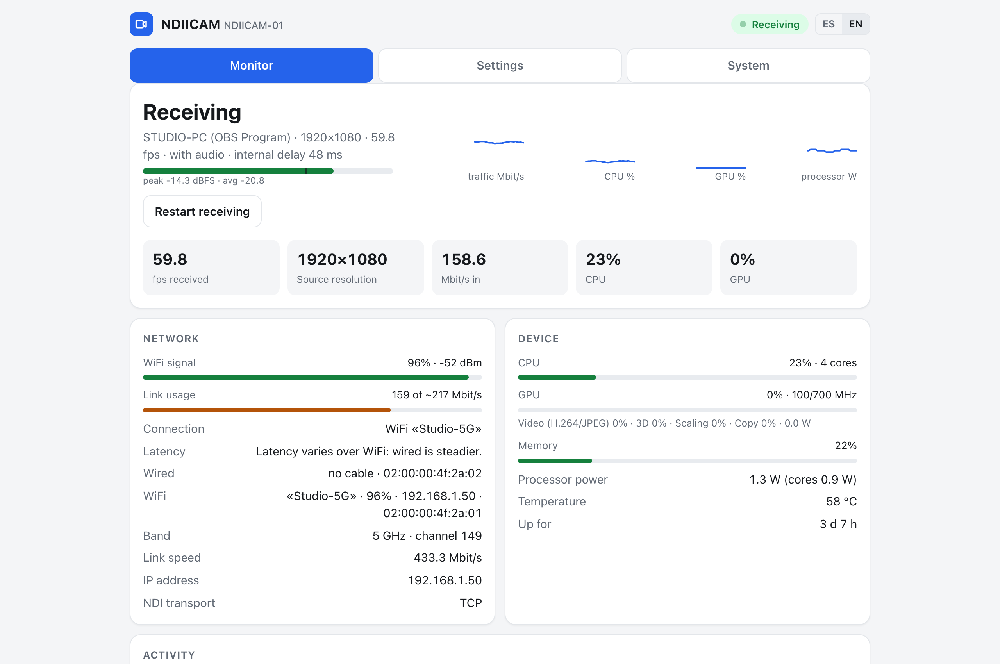

# NDIICAM

**Turn any x86_64 Linux PC (Intel/AMD) and a USB camera into a plug-and-play NDI® camera.**

[Español](README.es.md)

Plug a USB camera into a small PC and it shows up as an NDI source on your network —
in OBS, vMix, NDI Studio Monitor or any NDI receiver. Or turn it around: in **receiver mode**
it shows an NDI source from the network on the TV or monitor plugged into its HDMI, with
sound. Everything is managed from a web panel: no terminal needed after installation.

## Screenshots



<table>
  <tr>
    <td width="68%"></td>
    <td width="32%"></td>
  </tr>
  <tr>
    <td align="center">Per-camera settings (dark mode follows the system theme)</td>
    <td align="center">Setup WiFi on a phone</td>
  </tr>
  <tr>
    <td width="68%"></td>
    <td width="32%"></td>
  </tr>
  <tr>
    <td align="center">System: HTTPS, password, firewall, reason for the last boot and log</td>
    <td align="center">Password sign-in</td>
  </tr>
</table>



<sub>Screenshots use demo data (<code>docs/screenshots/demo.py</code>).</sub>

## Features

- **Streams every UVC camera plugged in as its own NDI source** (MJPEG or YUYV) at 720p or 1080p,
  up to 60 fps, **with the camera's microphone** as NDI audio when it has one.
- **Web panel** at `https://<device>.local`, password protected: live status, frame rate, bitrate, connected
  receivers, WiFi signal and link usage, CPU and temperature. In English and Spanish.
- **Setup WiFi**: with no known network in range, the device creates its own WiFi with a
  captive portal. Join it from your phone, pick your network, type the password, done.
- **Self-healing**: detects the camera when plugged in, restarts the stream if the camera
  stops sending frames, reconnects to known networks when they come back. If the whole
  device hangs, the board watchdog reboots it; the panel then tells you why it restarted.
- **Safe on other people's networks**: encrypted panel (HTTPS), mandatory password with an
  attempt limit, and a firewall that only opens what the current mode needs.
- **HDMI framing monitor**: shows one camera full screen on the monitor plugged into the device,
  straight to the GPU, with no CPU cost. On/off from the panel.
- **Receiver mode**: the device stops its cameras and becomes an NDI receiver: pick any NDI source
  on the network (OBS, vMix, a phone app, another NDIICAM…) and it plays on the HDMI output with
  its audio. It reconnects by itself if the source goes away. A small Atom cannot send and receive
  at the same time, so it is one mode or the other; on a powerful device the cameras keep
  streaming (see below).
- **H.264 output on the GPU**, per camera and alongside NDI: **record** MP4 files on the device
  (download them from the panel), serve an **SRT** stream for OBS, vMix or VLC, or **push RTMP** to
  YouTube, Twitch and the like. The GPU decodes the camera's JPEG and encodes H.264, so it costs
  little CPU; if it fails, NDI keeps going. Intel GPUs with VA-API.
- **Bridge mode, like an ATEM Streaming Bridge**: an ATEM Mini Pro, OBS or vMix streams to the
  device over RTMP or SRT and it plays on the HDMI output with its audio. The panel gives you the
  settings file to load into ATEM Software Control.
- **Several things at once on powerful devices** (4 cores and a GPU that really decodes, or 8
  cores; NDIICAM measures it, and on tight devices everything stays as before):
  - **Send and receive at once**: in receiver or bridge mode the cameras keep going out over NDI
    while HDMI shows what is received.
  - **Several outputs per camera**: record, SRT and RTMP at the same time, each in its own GPU
    pipeline (if one fails, the others carry on). The Record button, on a camera streaming over
    SRT or RTMP, adds the recording without cutting the stream.
  - **Bridge to NDI**: what reaches bridge mode (ATEM, OBS, a phone) also goes out as the NDI
    source `DEVICE (Puente)`, with its audio, even with no monitor attached.
  - **Re-stream an NDI source**: any NDI source on the network is recorded and/or streamed over
    SRT or RTMP, encoded on the GPU, without OBS.
- **Audio from another interface, in sync**: when audio comes in through a separate USB
  interface it usually arrives before the camera's picture. Each camera has an **audio delay**
  that applies live, without a cut, and a **Calibrate with claps** button: clap three times in
  front of the camera and it measures the offset (hit in the audio against movement in the
  picture). Tested end to end: from 284 ms ahead down to 17 ms.
- **GPU usage in the panel**: how busy it is, its video engine, frequency and power.
- **Audio meter**: peak and average level in dBFS for every camera, and for what the receiver or
  the bridge plays. You know before going live whether a microphone is dead, low or clipping.
- **Record on a schedule or on demand**: the GPU recording of each camera can run always, only
  while NDI receivers are connected, or between two times of day (overnight ranges work). It
  starts and stops without touching the NDI stream.
- **Tally**: when a receiver such as OBS, vMix or a TriCaster puts a camera on program or
  preview, the panel shows **ON AIR** or **PREVIEW** on that camera and logs it. It comes from the
  NDI SDK through a small patch NDIICAM adds to the GStreamer NDI plugin (`plugin/`), which also
  counts the receivers the SDK sees.
- **Help screen on HDMI**: when nothing is being shown, the monitor plugged into the device shows
  its status, mode, network, IP and a **QR code that opens the panel**, instead of a Linux login
  prompt. In the panel's language of choice. It costs no CPU.
- **Static IP, backup/restore, factory reset and one-click updates** from the panel.
- **Adaptive JPEG decoding**: if the camera's pictures get too detailed for one core (night,
  crowds, foliage), decoding is split across more threads by itself, so 1080p30 holds.
- **Light**: one Python service on top of GStreamer, no web frameworks, no database. Split into
  small modules (see the header of `ndiicam/ndiicam.py`), with tests that run without hardware
  (`python3 -m unittest discover -s tests`).

## Lite and Pro editions

It is the same NDIICAM and the same installer: the edition is chosen by itself at startup,
from the hardware. NDIICAM measures the GPU the first time (see [Technical notes](#technical-notes))
and the panel shows **LITE** or **PRO** next to the name, and under *System › Device* what a
Lite device is missing to be Pro.

| | Lite | Pro |
|---|---|---|
| Device | Any x86_64 PC (an Atom or a 2-core Celeron will do) | 4 cores, 3.5 GB and an Intel GPU that really decodes (or 8 cores without one) |
| Cameras over NDI, panel, setup WiFi, tally, HDMI | Yes | Yes |
| Receiver and bridge modes | Yes, with the cameras paused | Yes, **with the cameras streaming** |
| GPU H.264 output per camera | One (record, SRT or RTMP) | **Several at once** |
| Bridge publishes what it receives as an NDI source | No | Yes |
| Re-stream an NDI source (record or stream it) | No | Yes |
| Audio delay and clap calibration | Yes | Yes |

On a Pro device, the *Pro features* switch (in *Settings › Device mode*) turns them off and
makes it behave like Lite.

## Requirements

| | |
|---|---|
| CPU | x86_64 Intel or AMD. An Atom x5-Z8350 (4 cores, 1.44 GHz) handles 1080p30 using ~1.6 cores as a sender, and receives 1080p30 with ~0.6-0.9 cores |
| OS | Ubuntu 24.04 LTS (tested). Debian 12+ should work |
| Camera | USB UVC camera with MJPEG (most webcams, DJI Osmo Pocket 3 in webcam mode…). Cheap HDMI-to-USB capture sticks are UVC MJPEG too and should work as a camera (not tested yet) |
| WiFi card (optional) | Needed for the setup WiFi. Cards that support AP + client at once (e.g. Intel 3165) keep the client connection while the setup WiFi is on |

## Install

```bash
git clone https://github.com/ithesk/NDIICAM.git
cd NDIICAM
sudo ./install.sh
```

Or in one line:

```bash
curl -fsSL https://raw.githubusercontent.com/ithesk/NDIICAM/main/install.sh | sudo bash -s -- --accept-ndi-license
```

The installer:

1. Installs the dependencies (GStreamer, NetworkManager, hostapd, Avahi…).
2. Downloads the **NDI® SDK** runtime from the official NDI servers. It is proprietary
   software by Vizrt NDI AB: you are asked to accept its license
   (`--accept-ndi-license` accepts it without asking).
3. Installs the GStreamer NDI plugin from
   [gst-plugins-rs](https://gitlab.freedesktop.org/gstreamer/gst-plugins-rs) (MPL-2.0),
   prebuilt by this repository's CI (`--build-plugin` builds it locally instead).
4. Installs and starts the `ndiicam` service.
5. Moves the network to **NetworkManager** if it is managed by netplan + systemd-networkd
   (Ubuntu Server). The network drops for a few seconds; if it is not back within 90 s, the
   previous configuration is restored automatically. Skip with `--no-network`. The DHCP
   identity is preserved so the router keeps giving the same IP.

Running the installer again updates NDIICAM and keeps your settings.

## First use

1. Plug in the camera. Streaming starts by itself.
2. Open `https://<device>.local` (the installer prints the address). The browser warns about
   the certificate: it is the device's own, accept it (the fingerprint is under *System →
   Security* to check it). The first time, the panel asks you to **create the password**.
3. In OBS: *Add source → NDI Source* (with [DistroAV](https://github.com/DistroAV/DistroAV))
   and pick `<DEVICE> (NDIICAM)`.

**No network?** After 60 s without any known network the device turns on the setup WiFi
`NDIICAM-XXXX` (password `ndiicam-setup`, change it in the panel). Join it from a phone:
the panel opens by itself. Pick your network and type its password. The result is shown on
the same screen; then go back to your network and open `https://<device>.local`.

## Panel

Three tabs: **Monitor** (what is happening), **Settings** (what you change) and **System**
(security, the device and the log). `#monitor`, `#config` and `#sistema` in the URL open one
directly.

| Tab | Section | What it does |
|---|---|---|
| Monitor | Status | Overall state, sources streaming, receivers, outgoing Mbit/s, CPU, GPU, last-2-minute graphs |
| Monitor | One card per camera | Live preview (a camera JPEG every 2 s), NDI name, mode, camera/sent fps, bitrate, dropped frames, audio with level meter, receivers by name, GPU output |
| Monitor | Recordings, Network, Device, Activity | Recorded files, WiFi signal and link usage, CPU/GPU/memory/power, event log |
| Settings | One card per camera | On/off, NDI name, 720p/1080p, fps, audio (camera mic, another input or none), camera format (automatic, MJPEG or uncompressed), H.264 output on the GPU (record, SRT or RTMP), its quality and when to record |
| Settings | Device mode | Sender (cameras to NDI), receiver (an NDI source to HDMI) or bridge (RTMP/SRT from an ATEM to HDMI) |
| Settings | Bridge | Bridge mode only: RTMP server and key, SRT address, who is streaming, settings file for ATEM Software Control, new key |
| Settings | NDI receiver | Receiver mode only: NDI sources found on the network, which one to show, resolution, fps and audio received |
| Settings | HDMI output | On/off, which camera, monitor status, screen resolution at boot |
| Settings | Updates | Installed and latest version, check, install with one click |
| Settings | WiFi networks | Saved networks (forget), scan, connect |
| Settings | IP address | DHCP or static, for the active connection or for the wired port (even unplugged: saved and applied when the cable goes in). A static address with no connectivity reverts by itself |
| Settings | Device | Device name, NDI transport, setup WiFi name and password, country, HDMI help screen language, backup download/restore, factory reset |
| System | Security | Encrypted connection and certificate fingerprint, change password, sign out, firewall (on/off, open ports, extra ports) |
| System | Device | Reason for the last boot (from the panel, orderly shutdown, kernel failure, watchdog or power cut) and the last sign of life before it, watchdog status, clock and time zone, reboot, shut down |
| System | Log | The systemd journal: NDIICAM, the whole system or the kernel; this boot or earlier ones; by level and with search; downloadable |

### Security

- **HTTPS**: the panel runs on port 443 with the device's own certificate (created at install
  time, recreated if the name changes). Port 80 only redirects. The browser warns the first
  time because no known authority signs it.
- **Mandatory password**, at least 8 characters, chosen on the first visit (there is no
  default one). Five failures in a row from one IP lock it for 30 s, each further round
  doubles it, up to 15 min; there is also a cap of 30 failures per minute across all IPs.
  Sessions last 30 days with use and survive updates; changing the password signs out the
  others.
- Scripts (Companion, curl) can also use *Basic Auth* with the panel password:
  `curl -k -u :PASSWORD https://<device>.local/api/estado`.
- **Not asked from the setup WiFi**: anyone on it already knows its password, and it is the
  way back in if you forget the panel password. So change its default password
  (`ndiicam-setup`); the panel warns until you do.
- **Firewall**: its own nftables table (`inet ndiicam`) that only lets in SSH, the panel,
  mDNS, the setup WiFi's DHCP/DNS and, depending on the mode, NDI (5959-5999), the cameras'
  SRT or the bridge's RTMP/SRT. It does not touch other system rules. If the device runs other
  services, add their ports under *Extra ports*.

### Reliability

The installer leaves the device ready to run with nobody around:

- **Board watchdog** (ACPI WDAT, Intel TCO or AMD), fed by systemd: if the device freezes
  completely, the board reboots it after 30 s. Ubuntu blacklists these modules, so the
  `ndiicam-watchdog` service loads them by name.
- **Reboot after a kernel failure** in 10 s (`kernel.panic`), instead of sitting frozen.
- **Persistent log** (journald, up to 200 MB) and panel events saved to disk: after a reboot
  you can see what happened before.

## Technical notes

These come from building it on real hardware, and explain some of the defaults:

- **NDI transport defaults to TCP.** With NDI 6's default reliable UDP, some receivers
  (OBS on macOS in our tests) saw the source but never got video. TCP works everywhere.
  You can switch to UDP in the panel.
- **Avahi is required.** The NDI SDK on Linux announces sources through Avahi; without it
  the stream runs but no receiver can find it.
- **WiFi power saving is turned off** (`wifi.powersave = 2`): it causes stutter in a
  constant ~90 Mbit/s stream.
- **The pipeline is split in threads.** Decoding, color conversion and NDI encoding run in
  separate threads through leaky queues. In a single thread, an Atom only reaches ~22 fps
  at 1080p; split, it holds 30 fps. If the CPU falls behind, old frames are dropped instead
  of building latency.
- **No GPU, measured three ways.** On Intel Cherry Trail (i965 driver) `vaapijpegdec` runs at
  30-60 fps using 10-40% CPU, but every frame comes out black: the decoded surfaces cannot be read
  back to system memory. The driver exposes no video processing (VPP), so there is no GPU scaling or
  color conversion either. OpenGL ES works headless (EGL/GBM) and scales 720p→1080p at 24% CPU into
  memory, but feeding `kmssink` from it drops to 11 fps. NDI's SpeedHQ encoding is CPU-only anyway;
  NDI|HX with hardware H.264 would need the NDI Advanced SDK.
- **JPEG decoding is the sender's bottleneck.** `jpegdec` is single-threaded: a real 1080p30 camera
  frame (~210 KB) takes 68% of one core, a very detailed one more than 100%, which drops to ~21 fps
  while the other cores sit idle. Color conversion is cheap (10-16%) and feeding NDI I420 instead of
  UYVY saves nothing (the SDK converts internally). With `decodificadores` on automatic, the service
  starts with one decoder and, when the camera delivers more frames than NDI sends, restarts the
  source with frames split across 2-3 decoders in round robin, reordered afterwards. Measured scaling:
  1 → 21.8 fps, 2 → 40.5, 3 → 59.3 fps on heavy frames; +10% CPU when it is not needed.
- **HDMI output goes straight to a GPU video plane** (`kmssink`, UYVY), so it costs no CPU. Some
  planes cannot scale (Intel Cherry Trail): to see it full screen, set the screen resolution to
  the camera's in the panel. It writes `video=` to `/etc/default/grub.d/90-ndiicam.cfg` and needs a
  reboot. Custom GRUB entries with a fixed command line do not pick it up: add `video=1920x1080@60`
  to them by hand. Converting to RGB to scale on the CPU costs +70-150% CPU on an Atom.
- **Receiver mode plays the NDI source on a GPU video plane too.** NDI decodes to UYVY, which goes
  to the plane as is: receiving 1080p30 took ~0.6-0.9 cores on the Atom, depending on the picture.
  `kmssink` needs `skip-vsync`, or it waits two refreshes per frame and stops at 30 fps on a 60 Hz
  screen. Sources at another resolution are scaled by the plane itself, in hardware and keeping
  the aspect ratio: on an i3-8145U, 1080p to a 2560×1440 screen took 5% of one core, against
  55-75% scaling on the CPU. If the plane cannot scale (Cherry Trail), `kmssink` turns scaling off,
  the receiver notices and restarts scaling on the CPU (nearest neighbour, with borders), and that
  is expensive: OBS's per-source "NDI Output" filter sends each source at its native size
  **with transparency**, and a 2530×1378 screen capture took ~3 cores and once froze the Atom.
  Send the program instead (DistroAV main output, OBS output resolution = screen resolution).
  The receiver runs at low priority and leaves one core free for the system and the network.
- **Processor power** in the panel comes from Intel RAPL and covers the SoC (CPU + GPU) only, not
  WiFi, memory, board or camera. On the Atom: 0.9 W idle, 1.7 W streaming 1080p30.
- **H.264 output on the GPU** takes the camera's JPEG, decodes it on the GPU (`vajpegdec`) and
  encodes H.264 there too (`vah264enc` or `vah264lpenc`), in its own pipeline fed with copies: if
  the GPU, the network or the disk fail, NDI does not notice, and the output retries every 10 s.
  On a Celeron J3355 it costs ~15% of one core with NDI at 1080p30 at the same time.
  Recordings are fragmented MP4 (readable even after a power cut), 10 minutes each, in
  `/var/lib/ndiicam/grabaciones`; when less than 2 GB is left, the oldest are deleted.
- **The GPU also decodes for NDI and bridge mode, when it pays off.** With the video processor
  (`vapostproc`, in the `intel-media-va-driver-non-free` driver, which the installer adds when
  available), the GPU decodes the cameras' JPEG and bridge mode's H.264 and hands them over as
  UYVY; the CPU only copies the frame to memory. Whether that pays off depends on the chip: on an
  i3-8145U (UHD 620) a very detailed 1080p JPEG took 4 times less CPU and 1080p60 H.264 half; on a
  Celeron J3355 (Apollo Lake) copying the frame took 10 times more than decoding on the CPU (145 ms
  per frame against 14) and, with very detailed pictures, **froze the whole device**. So NDIICAM
  measures it on each device: it decodes a few test seconds on the CPU and on the GPU (in a
  separate process) and uses the GPU only if it takes at most 80%. The result is kept in
  `/var/lib/ndiicam/gpu-vpp.json` and measured again when the kernel, driver or GPU change.
  Apollo Lake, Gemini Lake and Cherry Trail are never measured, and if the device restarts during
  a measurement, that GPU is never tried again. If the GPU fails with a camera or a stream, it
  carries on on the CPU without a cut and logs it. With `decodificadores` set to a fixed number,
  always the CPU.
- **The GPU output needs 4:2:0 JPEG, or the video processor.** Its H.264 encoder only takes 4:2:0;
  with `vapostproc` the GPU converts 4:2:2 before encoding. Without a video processor (free iHD
  driver) nothing converts 4:2:2. Webcams and the DJI Osmo Pocket 3 send 4:2:0; HDMI capture cards
  like the Elgato Cam Link 4K send 4:2:2, so without `vapostproc` the GPU output says so and stays
  off.
- **Intel Gen9 GPUs (Skylake to Gemini Lake) need the HuC firmware** for their low-power encoder,
  and the kernel does not load it by default: without it, that encoder **froze the whole device**.
  The installer adds `i915.enable_guc=2` (in `/etc/default/grub.d/80-ndiicam-huc.cfg`) and asks
  for a reboot; until then the GPU output stays off. It also installs the iHD driver
  (`intel-media-va-driver-non-free` when the repositories have it, which brings the video
  processor; otherwise `intel-media-va-driver`): the old i965 cannot hand over a decoded 4:2:0 JPEG.
- **Bridge mode** runs [MediaMTX](https://github.com/bluenviron/mediamtx) as the RTMP (1935) and SRT
  (8890) server, accepting only `live/<key>`, and plays it on HDMI. It decodes H.264 with FFmpeg on
  the CPU: 1080p30 took ~45% of the CPU of a Celeron J3355, and 1080p60 decodes too. If the GPU
  measurement comes out in its favour (see above), the GPU decodes it (`vah264dec` +
  `vapostproc`). Not on Apollo Lake: its frames cannot reach the screen without expensive copies
  (the video planes do not take NV12, copying them to memory is very slow, i965 crashes in
  GStreamer 1.24, and OpenGL straight on KMS froze the device). A 4K screen runs at 30 Hz
  on these chips: for 60 fps, set the screen to 1080p in the panel.
- **The HDMI help screen** is a PNG drawn with Pillow (QR with segno) and shown with `kmssink` in
  PAUSED state: the prerolled frame stays on the video plane and the process never works again.
  The service restarts it when the IP, mode or state change, and stops it before a camera or the
  receiver take the HDMI. The installer disables the text console on tty1 (`getty@tty1`) so it
  does not fight for the screen; Alt+F2 still opens a console.
- **Uncompressed video on USB 3.0.** On a USB 3.0 port, cameras and capture cards that offer
  uncompressed video (YUYV) are used that way by default, which skips decoding JPEG. Measured with
  an Elgato Cam Link 4K on a Celeron J3355 at 1080p60: the camera process went from 154 % to 104 %
  of a core, the whole device from 93 % to 82 %, with no dropped frames and 18 ms less delay. At
  1080p30 the gain is smaller (60 % → 55 % of the device): moving ~124 MB/s over USB costs kernel
  time too. MJPEG is kept when the GPU output is on (it starts from the JPEG) and on USB 2.0, where
  uncompressed 1080p does not fit. The preview then comes from a scaled frame every 2 s.
- **Tally and the receiver count** need `NDIlib_send_get_tally` and `NDIlib_send_get_no_connections`
  from the NDI SDK, which the GStreamer NDI plugin does not expose. `plugin/ndisink-tally.patch`
  adds them to `ndisink` as read-only properties (`tally-program`, `tally-preview`, `connections`);
  the CI and the installer apply it before building. With an unpatched plugin, NDIICAM simply
  does not show tally.
- **GPU usage** comes from the kernel with nothing else installed: the time each engine works
  (`drm-engine-*` in each client's fdinfo), idle time (RC6), frequency (`gt_act_freq_mhz`) and the
  RAPL `uncore` domain for power.
- **The setup WiFi runs on a virtual `ap0` interface** when the card supports it, so the
  device keeps trying known networks meanwhile. Otherwise it alternates: AP for 3 minutes,
  then 45 s looking for networks, while nobody is connected to the AP.

## Latency

Measured on a Celeron J3355 over 5 GHz WiFi (October 2026). The panel shows the internal delay of
each camera (camera → NDI) and of the receiver or bridge (→ HDMI) live.

| Path | Delay | Notes |
|---|---|---|
| NDI, sender → receiver on the network | ~25 ms median, 10 % of frames above 200 ms | WiFi jitter; wired Ethernet is steadier. Add the camera's own delay and the internal one shown in the panel |
| GPU H.264 output (record, SRT, RTMP) | ~200 ms to encode and mux | Plus the player's buffer: SRT is configured with 200 ms; OBS/VLC add their own |
| Bridge, RTMP in → HDMI | 0.6 to 1.4 s inside the device | RTMP servers hand a new reader the stream from the last keyframe, so the lag depends on when it connected; the ATEM settings file asks for a keyframe every second to cut it. Plus the ATEM's own encoder delay. Not a low-latency path |
| Manual record button | starts with the next frame | the first time it also restarts the camera's stream (~2 s) to enable the GPU output |

### Lowering the latency

Each camera has a **Latency** setting:

| Mode | What it does | Inside the device (Cam Link 4K, 30 fps) |
|---|---|---|
| Normal | Each frame waits for the audio of its interval, so audio and video are in sync | ~100 ms |
| Low | Each frame goes out as soon as it arrives, with the audio already there; audio may trail by up to one frame. Needs the patched NDI plugin (`plugin/`) | see below |
| Minimum | No audio | ~33 ms |

Low and Minimum switch to 60 fps when the camera gives it uncompressed over USB 3.0, which halves
every one-frame wait. The rest of the delay is outside NDIICAM: wired Ethernet instead of WiFi
removes most of the jitter, and in OBS the NDI source's latency mode should be "Lowest". The SRT
output's buffer (200 ms by default) can go down to 80-120 ms on a local network.

## Troubleshooting

| Problem | Check |
|---|---|
| Source not listed in the receiver | `avahi-daemon` running; receiver and device on the same network/VLAN; mDNS not blocked by the WiFi (client isolation) |
| Source listed, no video | Set transport to TCP in the panel |
| Stutter over WiFi | Link usage bar in the panel; 5 GHz; use 720p; prefer Ethernet |
| Receiver mode is slow | The source does not match the screen or has transparency: send it at the screen resolution (in OBS, DistroAV main output) |
| Camera fps higher than NDI fps on an MJPEG camera | Decoding cannot keep up; the service adds decoder threads by itself (event "decoding cannot keep up"). Fix it by hand in *Device → JPEG decoding* |
| Panel unreachable | `systemctl status ndiicam`; something else on port 80 or 443 |
| Forgot the panel password | From the setup WiFi (it comes up by itself when the device has no known network) the panel does not ask for it: change it there. Or over SSH remove `clave_panel` from `/etc/ndiicam/config.json` and restart the service |
| A program on the device is no longer reachable | The firewall: add its port under *System → Security → Extra ports*, or turn it off |
| Logs | *System → Log* in the panel, or `journalctl -u ndiicam -f`; network migration log in `/var/lib/ndiicam/red.log` |

## Uninstall

```bash
sudo ./uninstall.sh                  # removes NDIICAM, keeps the network as it is
sudo ./uninstall.sh --restore-network --purge   # also restores netplan/networkd and removes SDK, plugin and settings
```

## License

NDIICAM is free software under the **GNU General Public License v3.0 or later**
([LICENSE](LICENSE)). Copyright © 2026 Pablo Holguín.

NDIICAM does not include the NDI® SDK: the installer downloads it from NDI and its own
license applies. **NDI® is a registered trademark of Vizrt NDI AB.** NDIICAM is not
affiliated with or endorsed by Vizrt NDI AB. The GStreamer NDI plugin is part of
gst-plugins-rs (MPL-2.0). Bridge mode uses [MediaMTX](https://github.com/bluenviron/mediamtx) (MIT),
which the installer downloads. **ATEM is a trademark of Blackmagic Design**; NDIICAM is not
affiliated with or endorsed by Blackmagic Design.
