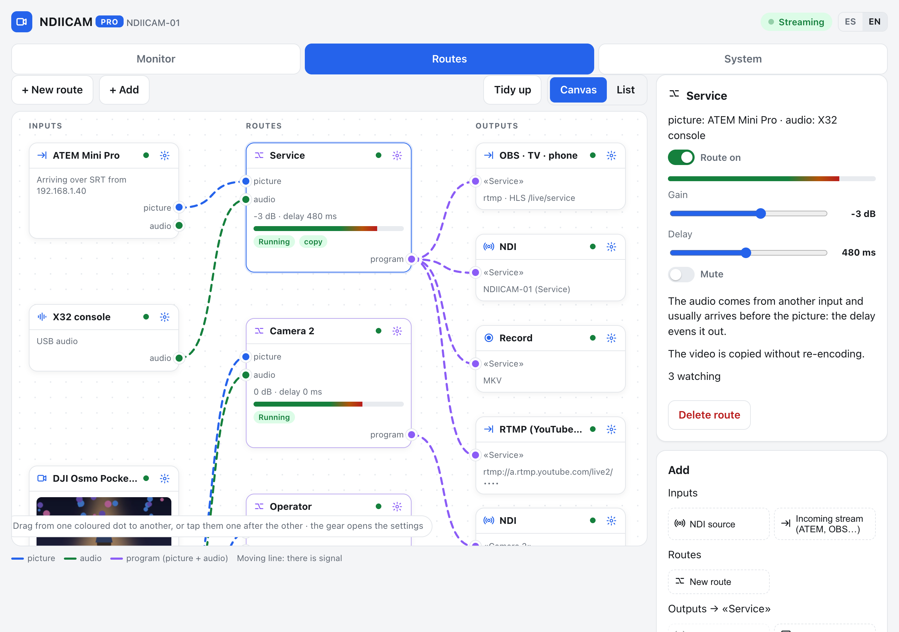
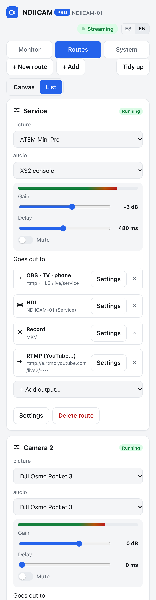
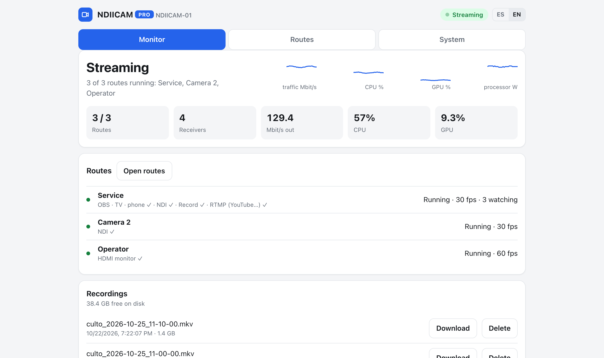

# Routes

*[Español](rutas.md)*

Routes are another way to run the device, meant for when it does several things at once.
Instead of picking a mode (sender, receiver or bridge) and setting up each piece on its own, you
draw what you want: **what comes in, how it is combined, and where it goes out**.



## The idea

```
 INPUTS                   ROUTES                         OUTPUTS
 ATEM (SRT)    ─picture▶ ┌──────────────────────┐ ─▶ OBS · TV · phone
 X32 console   ─audio──▶ │ Service              │ ─▶ NDI "Service"
                         │ −3 dB · delay 480 ms │ ─▶ Record MKV
                         └──────────────────────┘ ─▶ YouTube (RTMP)
 Pocket 3      ─picture▶ ┌──────────────────────┐
               ─audio──▶ │ Camera 2             │ ─▶ NDI "Pulpit"
                         └──────────────────────┘
 Multiview     ─picture▶ ┌──────────────────────┐
                         │ Operator             │ ─▶ HDMI monitor
                         └──────────────────────┘
```

- An **input** is anything that gives video, sound or both.
- A **route** pairs a video with an audio, which can come from another input, and sets its gain
  and delay. The result is a *program*.
- Each route goes out through the **outputs** you choose, all at once.

An NDI source or an incoming stream can be used in several routes. A USB camera or audio
interface cannot: the system only lets one process open them, so the second route that asks for
one stays stopped (camera) or goes without that audio (interface), with the reason shown.

## Turning them on

In **Settings**, press **Switch to routes**. Whatever you had set up with the modes becomes
equivalent routes. Cameras keep their NDI name, GPU outputs and audio delay, and the bridge
keeps its key, so the ATEM does not need setting up again.

To go back to the modes: **System › Back to modes**.
Your routes stay saved in case you come back.

## Inputs

| Input | Where it comes from | Gives |
|---|---|---|
| **USB camera** | shows up by itself when plugged in, with a preview even when no route uses it (while the panel is open) | video, and audio if it has a microphone |
| **USB audio** | shows up by itself: a mixing console, an interface or a USB microphone | audio |
| **NDI source** | *Add › NDI source*, then pick one on the network (OBS, vMix, another camera…) | video and audio |
| **Incoming stream** | *Add › Incoming stream*: an ATEM Mini Pro, OBS or a phone streams to the device over RTMP or SRT | video and audio |

Each incoming stream has **its own key**. Its gear shows both addresses
(`rtmp://<device>:1935/live` plus the key, or
`srt://<device>:8890?streamid=publish:live/<key>`) and the **Download ATEM settings** button: load the file
in *ATEM Software Control*. The card shows whether it is arriving, over which
protocol and from which IP.

## Routes

Each route has:

- **Picture**: a camera, an NDI source or an incoming stream.
- **Audio**: the same input's, another input's (the console, a USB interface) or none.
- **Gain**: from −24 to +12 dB.
- **Delay**: up to 1000 ms. It is for when the audio arrives before the picture (see below).
- **Mute**, and a **meter** with peak and average level to check the audio is arriving.
- **Route on**: a route can be switched off without deleting it.

Gain, delay and mute **apply live, without cutting**: you fine-tune them by ear while streaming.

When the video comes from an ATEM or OBS, it is **copied as is, without re-encoding**: the
*copy* tag says so. It uses no GPU and loses no quality.

## Outputs

| Output | What it does |
|---|---|
| **NDI** | The program as the NDI source `DEVICE (name)`. |
| **Monitor** | Shows it on a screen plugged into the device. **One route per screen**: with several monitors (DisplayPort, HDMI, USB-C), each route goes to its own (see below). |
| **OBS · TV · phone** | Makes it available on the network for anyone to read (see below). |
| **SRT** | The same, over SRT, for less reliable links. |
| **RTMP (YouTube…)** | Streams it to YouTube, Twitch, Facebook… with the service's URL and key. |
| **Record** | 10-minute MP4 or MKV files on the device, downloaded from *Monitor › Recordings*. When the disk fills up, it deletes the oldest. |

Addresses to read a route, where `<path>` is the route's name in lowercase with no spaces (the
output's gear shows it):

| Program | Address |
|---|---|
| OBS (media source or VLC) | `rtmp://<device>:1935/live/<path>` |
| TV, VLC | `http://<device>:8888/live/<path>/index.m3u8` |
| Phone browser | `http://<device>:8888/live/<path>/` |
| SRT | `srt://<device>:8890?streamid=read:live/<path>` |

Each network output (YouTube, record) runs in **its own process**: if YouTube drops or the disk
fails, the route's other outputs carry on.

### Several monitors

If the device has several video outputs, every connected monitor is one more screen:
- in the **Monitor** output's settings you pick which one (`DP-2`, `HDMI-A-1`…) or leave it on
  **automatic**, which takes the first free one;
- if two routes ask for the same screen, the first one in the list keeps it and the other says so;
- on the screens no route uses, the **help screen** with the QR appears, and its footer now
  names the connector, so you know which cable is which;
- a screen you plug in while running shows up by itself, ready to use.

Under the hood, the service owns the graphics card and **leases** each screen to the process
that draws on it (a DRM lease): the lease is exclusive and ends only when that process exits.
If the card does not allow it (an odd driver, missing permissions), everything works as before,
with a single monitor.

## The panel

### Canvas

Inputs are on the left, routes in the middle and outputs on the right.

- **Connect**: drag from one coloured dot to another, or tap them one after the other. Blue is the
  picture, green is audio and purple is the program.
- **Move an output to another route**: drag it onto the other route's dot.
- **Settings**: each block's gear (or a double-click on it) opens them in the right-hand panel.
- **Add**: the right-hand panel adds network inputs, routes and, with a route selected, its
  outputs.
- **Tidy up** lays the blocks out again. If you move them by hand, the browser remembers where.
- **Several at once**: Shift + click selects several blocks; they move together and Del deletes them.
- **Shortcuts**: `N` new route · `Del` deletes the selection · `Ctrl+S` apply · `Ctrl+Z` undo ·
  `Esc` close · `1`/`2`/`3` tabs · `?` reminds you.
- Wires **move when there is signal** and stay still when there is none.

### List and phone

In **List**, each route is a card with dropdowns for video and audio, the sliders and its
outputs. On a phone it is the only view, and settings open as a sheet from the bottom.



### Apply

Like Node-RED's *Deploy*: anything that restarts processes (inputs, outputs, sources, monitor,
switching a route on or off) **stays pending** until you press **Apply** (or Ctrl+S). The top bar
shows how many changes are not applied, and **Discard** goes back to what the device has. When
you apply, only the processes for what changed restart; everything else keeps streaming.

**Gain, delay and mute apply at once**, with no waiting: you fine-tune them by ear while
streaming. A camera's settings (resolution, fps, format, latency), in its input's gear, also apply
at once and restart only that camera.

If a route is missing something, it stays stopped and its card says why, for example:
- it has no video;
- the input is not connected;
- it has two NDI outputs with the same name;
- another route already uses the monitor;
- the RTMP URL is wrong.

### Monitor

With routes, the Monitor tab has a card per route: preview (when the picture is a camera), level
meter, camera and sent fps, Mbit/s, NDI receivers, who is reading the program, latency, drops,
tally, each output's state and its errors. Paused routes collapse to one line.



## Syncing audio from another input

When picture and sound come from different devices, for example the ATEM and the console, the
audio almost always arrives first: the picture goes through the camera, the switcher and the
encoder. The route's **delay** makes up for it:

- **USB camera routes**: the **Calibrate with claps** button measures it for you. You clap three
  times in front of the camera and it compares the hit in the audio with the motion in the
  picture.
- **ATEM or OBS routes**: set it by ear, with someone talking to camera, because the device does
  not measure that picture. Starting values:
  - an ATEM on the same network: about 350 ms;
  - over SRT: about 500 ms.

The delay is fixed: once set, it does not need touching while the setup stays the same. Also,
when the audio comes from another input, the picture is re-timed to the device's clock, so the
offset does not grow even over hours of streaming.

## An example: a church service

1. Plug in the console over USB: **Console** appears.
2. *Add › Incoming stream*, name it "ATEM" and load its settings into the ATEM. Start streaming on
   the ATEM.
3. *+ New route* "Service": video from the ATEM, audio from the console.
4. Give it the outputs **OBS · TV · phone**, **Record (MKV)** and **RTMP** with the YouTube key.
5. Plug the ATEM's multiview into a USB capture card. Create another route, "Operator", with that
   video and the **HDMI monitor** output.
6. Adjust the "Service" delay by ear until the lips match.

With this, OBS reads the program already in sync, the TV in the lobby watches it over HLS, the
recording stays on the device for the YouTube clips, and the operator has the multiview in front
of them.

## Lite and Pro

- **Pro**: all routes at once.
- **Lite**: **one route running**. The others stay paused, with the reason shown, and you can
  switch which one is on.

## Under the hood

- The panel saves routes in the config (`rutas`, `entradas_red` and `motor: "rutas"`).
- A pure planner (`ndiicam/rutas.py`) validates them and turns them into a list of processes. It
  touches nothing on the system and is tested without hardware.
- The supervisor (`MotorRutas` in `supervisor.py`) starts, stops or adjusts only the processes
  that change. It reuses the usual ones:
  - cameras: `fuente.py`, with the GPU;
  - an incoming stream: `programa.py`, which copies the video and adds the audio;
  - an NDI source: `reemision.py` and `receptor.py`;
  - recording and RTMP: `relevo.py`, one process per output.
- **MediaMTX is the internal bus**: each route with network outputs publishes its program on
  `live/<path>`, and OBS, the TV, SRT, recording and YouTube read it from there.
  - From outside, you can only *publish* on the incoming streams' keys.
  - Programs are published by the device itself only.
- With routes, the firewall opens both NDI sending and receiving, plus MediaMTX's ports: RTMP
  1935, SRT 8890 and HLS 8888.
