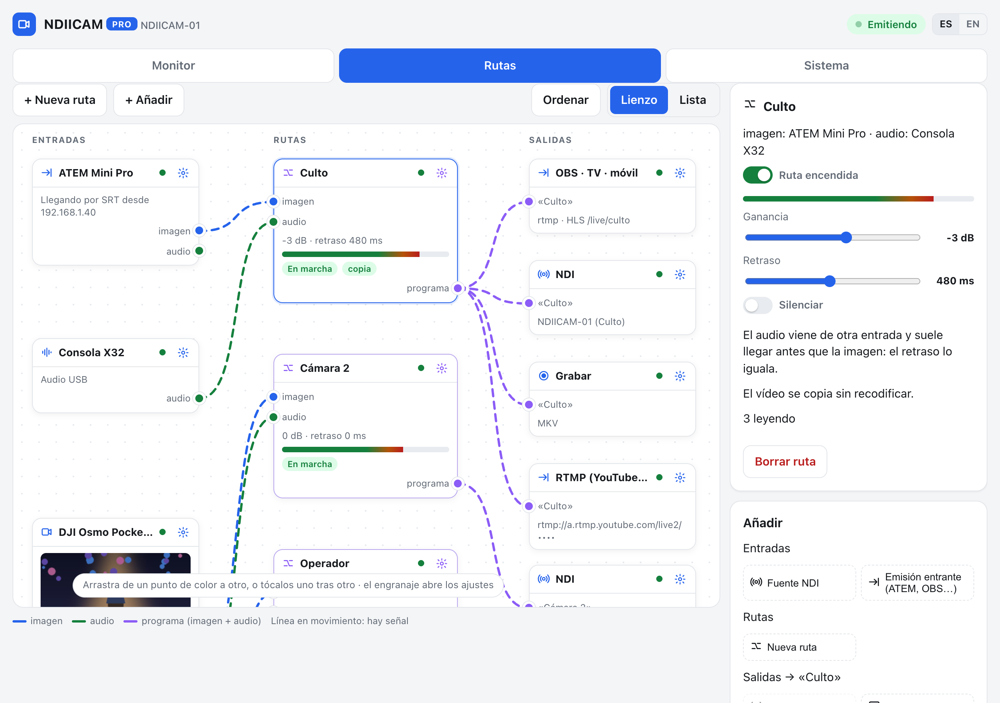
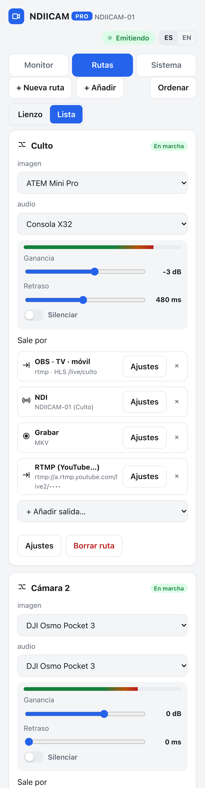
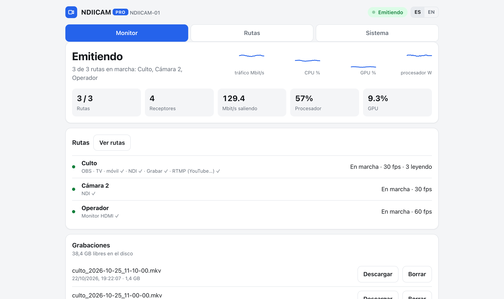

# Rutas

*[English](routes.md)*

Las rutas son otra forma de manejar el equipo, pensada para cuando hace varias cosas a la vez.
En vez de elegir un modo (emisor, receptor o puente) y ajustar cada pieza por su lado, se dibuja
lo que se quiere: **qué entra, cómo se junta y a dónde sale**.



## La idea

```
 ENTRADAS                 RUTAS                          SALIDAS
 ATEM (SRT)    ─imagen─▶ ┌──────────────────────┐ ─▶ OBS · TV · móvil
 Consola X32   ─audio──▶ │ Culto                │ ─▶ NDI «Culto»
                         │ −3 dB · retraso 480  │ ─▶ Grabar MKV
                         └──────────────────────┘ ─▶ YouTube (RTMP)
 Pocket 3      ─imagen─▶ ┌──────────────────────┐
               ─audio──▶ │ Cámara 2             │ ─▶ NDI «Púlpito»
                         └──────────────────────┘
 Multiview     ─imagen─▶ ┌──────────────────────┐
                         │ Operador             │ ─▶ Monitor HDMI
                         └──────────────────────┘
```

- Una **entrada** es algo que da imagen, sonido o los dos.
- Una **ruta** junta una imagen con un audio, que puede venir de otra entrada, y le ajusta la
  ganancia y el retraso. El resultado es un *programa*.
- Cada ruta sale por las **salidas** que quieras, todas a la vez.

Una fuente NDI o una emisión entrante pueden usarse en varias rutas. Una cámara o una interfaz
de audio USB no: el sistema solo deja abrirlas a un proceso, así que la segunda ruta que las pida
se queda parada (cámara) o sin ese audio (interfaz), con el motivo a la vista.

## Activarlas

En **Configuración**, pulsa **Pasar a rutas**. Lo que tengas montado con los modos se convierte
en rutas equivalentes. Las cámaras conservan su nombre NDI, sus salidas por GPU y su retraso de
audio, y el puente conserva su clave, así que el ATEM no hay que volver a configurarlo.

Para volver a los modos: **Sistema › Volver a los modos**.
Las rutas quedan guardadas por si vuelves a ellas.

## Entradas

| Entrada | De dónde sale | Da |
|---|---|---|
| **Cámara USB** | aparece sola al enchufarla, con vista previa aunque ninguna ruta la use (mientras el panel esté abierto) | imagen, y audio si tiene micrófono |
| **Audio USB** | aparece sola: una consola, una interfaz o un micrófono USB | audio |
| **Fuente NDI** | *Añadir › Fuente NDI* y eliges una de la red (OBS, vMix, otra cámara…) | imagen y audio |
| **Emisión entrante** | *Añadir › Emisión entrante*: un ATEM Mini Pro, OBS o un móvil emiten al equipo por RTMP o SRT | imagen y audio |

Cada emisión entrante tiene **su propia clave**. Su engranaje muestra las dos direcciones
(`rtmp://<equipo>:1935/live` con la clave, o
`srt://<equipo>:8890?streamid=publish:live/<clave>`) y el botón **Descargar ajustes para ATEM**: el archivo se
carga en *ATEM Software Control*. En la tarjeta se ve si está llegando,
por qué protocolo y desde qué IP.

## Rutas

Cada ruta tiene:

- **Imagen**: una cámara, una fuente NDI o una emisión entrante.
- **Audio**: el de la misma entrada, el de otra (la consola, una interfaz USB) o ninguno.
- **Ganancia**: de −24 a +12 dB.
- **Retraso**: hasta 1000 ms. Sirve para cuando el audio llega antes que la imagen (ver abajo).
- **Silenciar**, y un **medidor** de pico y nivel medio para ver que el audio llega.
- **Ruta encendida**: se puede apagar una ruta sin borrarla.

La ganancia, el retraso y el silencio **se aplican en marcha, sin cortar**: se afinan de oído
mientras se emite.

Cuando la imagen viene de un ATEM o de OBS, el vídeo **se copia tal cual, sin recodificar**: la
etiqueta *copia* lo indica. No gasta GPU y no pierde calidad.

## Salidas

| Salida | Qué hace |
|---|---|
| **NDI** | El programa como fuente NDI `EQUIPO (nombre)`. |
| **Monitor** | Lo muestra en una pantalla conectada al equipo. **Una ruta por pantalla**: con varios monitores (DisplayPort, HDMI, USB-C), cada ruta va al suyo (ver abajo). |
| **OBS · TV · móvil** | Lo deja disponible en la red, para que lo lea quien quiera (ver abajo). |
| **SRT** | Lo mismo, por SRT, para enlaces menos fiables. |
| **RTMP (YouTube…)** | Lo emite a YouTube, Twitch, Facebook… con la URL y la clave del servicio. |
| **Grabar** | Archivos MP4 o MKV de 10 minutos en el equipo, que se descargan desde *Monitor › Grabaciones*. Si el disco se llena, borra lo más viejo. |

Las direcciones para leer una ruta, con `<camino>` el nombre de la ruta en minúsculas y sin
espacios (lo muestra el engranaje de la salida):

| Programa | Dirección |
|---|---|
| OBS (fuente multimedia o VLC) | `rtmp://<equipo>:1935/live/<camino>` |
| TV, VLC | `http://<equipo>:8888/live/<camino>/index.m3u8` |
| Navegador del móvil | `http://<equipo>:8888/live/<camino>/` |
| SRT | `srt://<equipo>:8890?streamid=read:live/<camino>` |

Cada salida de red (YouTube, grabar) corre en **su propio proceso**: si YouTube corta o el disco
falla, las demás salidas de esa ruta siguen.

### Varios monitores

Si el equipo tiene varias salidas de vídeo, cada monitor conectado es una pantalla más:
- en los ajustes de la salida **Monitor** eliges cuál (`DP-2`, `HDMI-A-1`…) o lo dejas en
  **automático**, que coge el primero libre;
- si dos rutas piden la misma pantalla, se la queda la primera de la lista y la otra lo dice;
- en las pantallas que ninguna ruta usa sale la **pantalla de ayuda** con el QR, que ahora
  indica en el pie qué conector es: así sabes qué cable es cuál;
- una pantalla que enchufes en marcha aparece sola y queda lista para usar.

Por dentro, el servicio es el dueño de la tarjeta gráfica y **alquila** cada pantalla al
proceso que la pinta (DRM lease): el alquiler es exclusivo y caduca solo cuando el proceso
termina. Si la tarjeta no se deja (un driver raro, sin permisos), todo sigue como antes, con
un solo monitor.

## El panel

### Lienzo

Las entradas van a la izquierda, las rutas en el centro y las salidas a la derecha.

- **Conectar**: arrastra de un punto de color a otro, o tócalos uno tras otro. El azul es la
  imagen, el verde el audio y el morado el programa.
- **Mover una salida a otra ruta**: arrástrala sobre el punto de la otra ruta.
- **Ajustes**: el engranaje de cada bloque (o un doble clic en él) los abre en el panel de la derecha.
- **Añadir**: el panel de la derecha añade entradas de red, rutas y, con una ruta elegida, sus
  salidas.
- **Ordenar** recoloca los bloques. Si los mueves a mano, el navegador recuerda dónde.
- **Varios a la vez**: Mayús + clic selecciona varios bloques; se mueven juntos y Supr los borra.
- **Atajos**: `N` nueva ruta · `Supr` borra lo seleccionado · `Ctrl+S` aplicar · `Ctrl+Z` deshacer ·
  `Esc` cerrar · `1`/`2`/`3` pestañas · `?` los recuerda.
- Los cables **se mueven cuando hay señal** y se quedan quietos cuando no.

### Lista y móvil

En **Lista**, cada ruta es una tarjeta con desplegables para la imagen y el audio, los
deslizadores y sus salidas. En el móvil es la única vista, y los ajustes salen como una hoja
desde abajo.



### Aplicar

Como el *Deploy* de Node-RED: lo que reinicia procesos (entradas, salidas, fuentes, monitor,
encender o apagar una ruta) **queda pendiente** hasta que pulses **Aplicar** (o Ctrl+S). Arriba
se ve cuántos cambios hay sin aplicar, y **Descartar** vuelve a lo que tiene el equipo. Al aplicar,
solo se reinician los procesos de lo que ha cambiado; el resto sigue emitiendo.

**Ganancia, retraso y silencio se aplican al momento**, sin esperar: se afinan de oído mientras
se emite. Los ajustes de una cámara (resolución, fps, formato, latencia), que están en el engranaje
de su entrada, también van al momento y reinician solo esa cámara.

Si a una ruta le falta algo, se queda parada y la tarjeta dice por qué, por ejemplo:
- no tiene imagen;
- la entrada no está conectada;
- tiene dos salidas NDI con el mismo nombre;
- otra ruta ya usa el monitor;
- la URL de RTMP está mal.

### Monitor

Con rutas, la pestaña Monitor tiene una tarjeta por ruta: vista previa (si la imagen es una
cámara), vúmetro, fps de la cámara y enviados, Mbit/s, receptores NDI, quién lee el programa,
latencia, descartes, tally, el estado de cada salida y sus errores. Las rutas en pausa quedan en
una línea.



## Sincronizar el audio de otra entrada

Cuando la imagen y el sonido vienen de aparatos distintos, por ejemplo el ATEM y la consola, el
audio casi siempre llega antes: la imagen pasa por la cámara, el mezclador y el codificador. El
**retraso** de la ruta lo compensa:

- **Rutas de cámara USB**: el botón **Calibrar con palmadas** lo mide solo. Das tres palmadas
  delante de la cámara y compara el golpe en el audio con el movimiento en la imagen.
- **Rutas de un ATEM o de OBS**: se ajusta de oído, con alguien hablando a cámara, porque esa
  imagen no la mide el equipo. Valores de partida:
  - un ATEM por la misma red: unos 350 ms;
  - por SRT: unos 500 ms.

El retraso es fijo: una vez ajustado, no hay que tocarlo mientras no cambie el montaje. Además,
cuando el audio viene de otra entrada, la imagen se reajusta al reloj del equipo, así que el
desfase no crece aunque la emisión dure horas.

## Un ejemplo: el culto

1. Conecta la consola por USB: aparece **Consola**.
2. *Añadir › Emisión entrante*, llámala «ATEM» y carga sus ajustes en el ATEM. Pon el ATEM a
   transmitir.
3. *+ Nueva ruta* «Culto»: imagen del ATEM y audio de la consola.
4. Añádele las salidas **OBS · TV · móvil**, **Grabar (MKV)** y **RTMP** con la clave de
   YouTube.
5. Conecta el multiview del ATEM a una capturadora USB. Crea otra ruta, «Operador», con esa
   imagen y la salida **Monitor HDMI**.
6. Ajusta el retraso de «Culto» de oído hasta que los labios cuadren.

Con esto, OBS lee el programa ya sincronizado, la tele de la entrada lo ve por HLS, la grabación
queda en el equipo para los cortes de YouTube y el operador tiene el multiview delante.

## Lite y Pro

- **Pro**: todas las rutas a la vez.
- **Lite**: **una ruta en marcha**. Las demás se quedan en pausa, con el motivo a la vista, y
  puedes cambiar cuál está encendida.

## Por dentro

- El panel guarda las rutas en la configuración (`rutas`, `entradas_red` y `motor: "rutas"`).
- Un planificador puro (`ndiicam/rutas.py`) las valida y las convierte en una lista de procesos.
  No toca nada del sistema y se prueba sin hardware.
- El supervisor (`MotorRutas` en `supervisor.py`) arranca, para o ajusta solo los procesos que
  cambian. Reutiliza los de siempre:
  - las cámaras: `fuente.py`, con la GPU;
  - una emisión entrante: `programa.py`, que copia el vídeo y le pone el audio;
  - una fuente NDI: `reemision.py` y `receptor.py`;
  - grabar y RTMP: `relevo.py`, un proceso por salida.
- **MediaMTX hace de bus interno**: cada ruta con salidas de red publica su programa en
  `live/<camino>`, y de ahí lo leen OBS, la TV, el SRT, la grabación y YouTube.
  - Desde fuera solo se puede *publicar* en las claves de las emisiones entrantes.
  - Los programas solo los publica el propio equipo.
- Con rutas, el cortafuegos abre a la vez lo de emitir y recibir NDI y lo de MediaMTX: RTMP 1935,
  SRT 8890 y HLS 8888.
